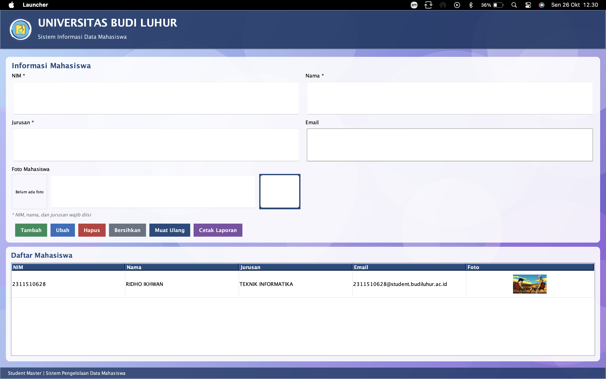
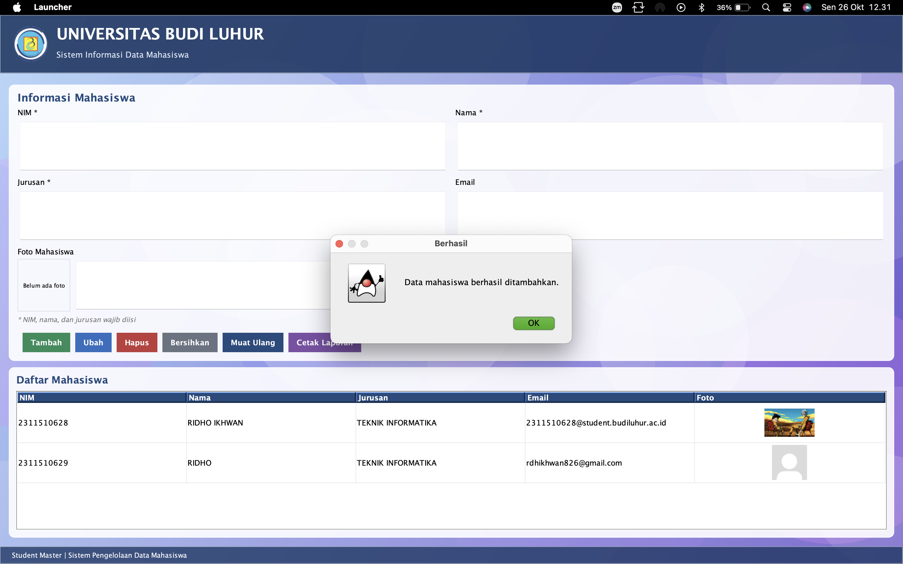
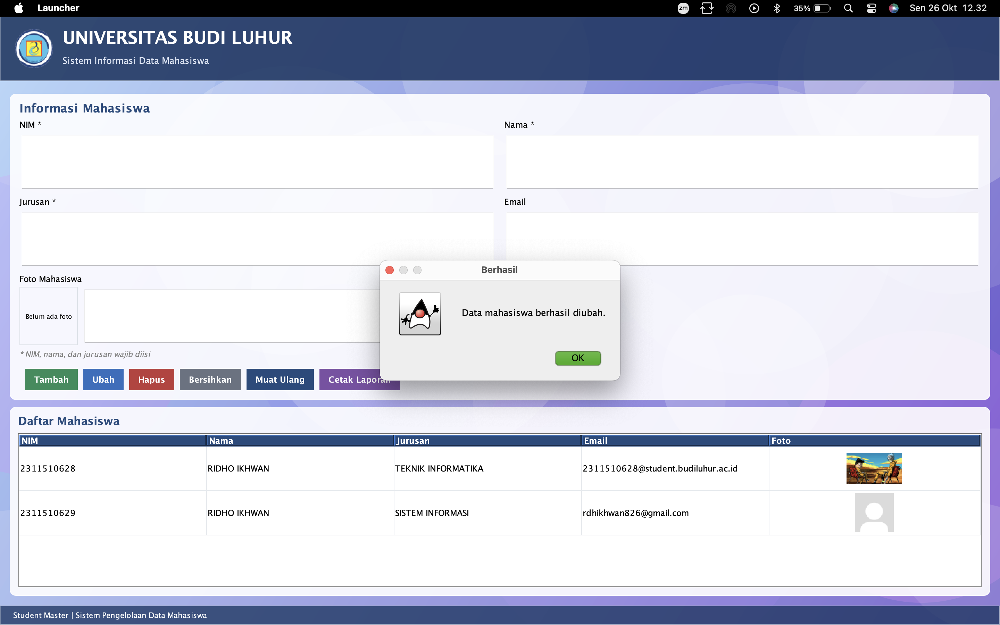
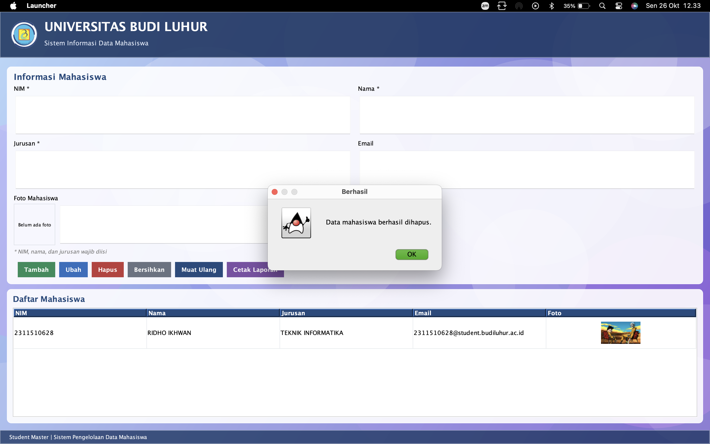
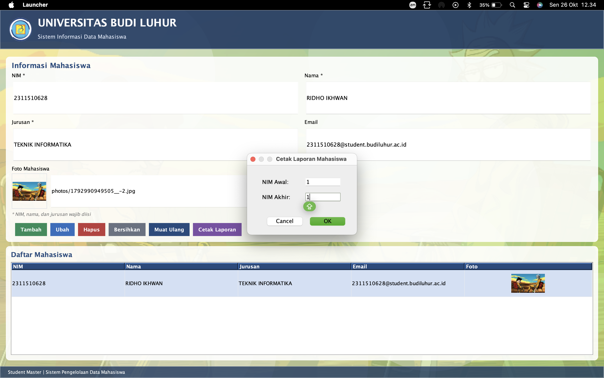
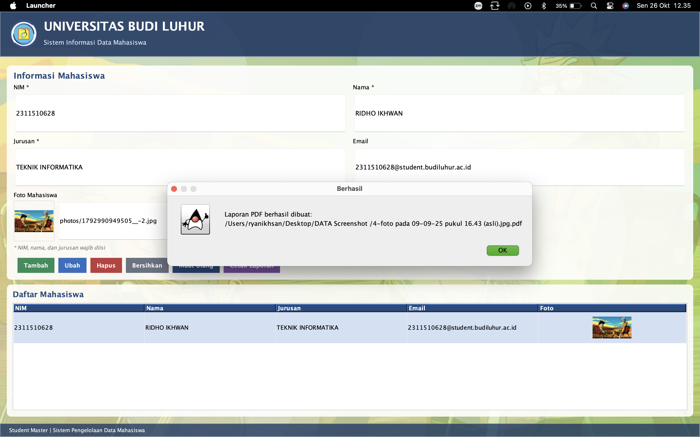

# Student Master – Universitas Budi Luhur

Aplikasi desktop pengelolaan data mahasiswa berbasis **Java Swing** dengan database **SQLite** dan laporan PDF menggunakan **JasperReports**. Dibuat sebagai tugas UAS IPBO.

> **Nama:** Ridho Ikhwan  
> **NIM:** 2311510628  
> **Mata kuliah:** IPBO – Universitas Budi Luhur

## Fitur

### CRUD data mahasiswa
- **Tambah**, **Ubah**, **Hapus**, **Bersihkan**, dan **Muat Ulang** data mahasiswa.
- Validasi: NIM, nama, dan jurusan wajib diisi; NIM tidak boleh duplikat.
- Data tersimpan di SQLite (`studentmaster.db`).

### Tampilan (UI)
- Latar belakang berupa **gradasi warna dan gambar dekoratif**, bukan warna polos.
- **Latar berbeda untuk setiap mahasiswa**: warna dan pola dihasilkan dari NIM, dan foto mahasiswa ikut tampil samar di latar saat barisnya dipilih.
- Foto mahasiswa tampil sebagai **thumbnail di tabel** dan preview di form. Foto disalin ke folder `photos/` sehingga ikut tersimpan di repository.
- Logo Universitas Budi Luhur di header aplikasi.

### Laporan PDF (JasperReports)
- **Form rentang NIM**: pengguna mengisi NIM awal dan NIM akhir.
- Query memakai klausa `WHERE nim >= ? AND nim <= ?` untuk menyaring data.
- **Logo** di bagian header laporan.
- **Nomor halaman dan jumlah halaman** di footer (contoh: `Halaman 1 dari 3`).
- Hasil laporan disimpan sebagai file **.pdf**.

## Teknologi

| Komponen | Versi |
|---|---|
| Java | 21 |
| Build tool | Maven |
| UI | Java Swing |
| Database | SQLite (`sqlite-jdbc` 3.49.1.0) |
| Laporan | JasperReports 6.21.3 |

## Struktur proyek

```
student-master/
├── captures/                     # screenshot CRUD & laporan (.png)
├── photos/                       # foto mahasiswa yang diunggah
├── src/main/java/com/studentmaster/
│   ├── App.java                  # titik masuk aplikasi
│   ├── dao/StudentDAO.java       # akses data (CRUD)
│   ├── database/Database.java    # koneksi & inisialisasi SQLite
│   ├── model/Student.java        # model data mahasiswa
│   ├── report/                   # dialog rentang NIM & pembuat PDF
│   └── ui/                       # form utama, latar & panel kustom
├── src/main/resources/
│   ├── StudentReport.jrxml       # template laporan JasperReports
│   └── images/logo.png           # logo
├── studentmaster.db              # database SQLite
└── pom.xml
```

## Cara menjalankan

Prasyarat: **JDK 21** dan **Maven**.

```bash
git clone <url-repository-ini>
cd <nama-repository>/student-master   # folder yang berisi pom.xml
mvn clean compile
mvn exec:java -Dexec.mainClass=com.studentmaster.App
```

Atau buka proyek di VS Code / IntelliJ lalu jalankan `App.java`.

> Jalankan aplikasi dari folder `student-master` agar `studentmaster.db` dan folder `photos/` terbaca dengan benar.

## Cara mencetak laporan

1. Klik **Cetak Laporan**.
2. Isi **NIM Awal** dan **NIM Akhir**, lalu klik OK.
3. Pilih lokasi dan nama file PDF, lalu simpan.

## Screenshot

Seluruh screenshot aksi CRUD dan laporan tersimpan di folder [`captures/`](captures/).

| Aksi | Screenshot |
|---|---|
| Tampilan utama / daftar data (Read) |  |
| Tambah (Create) |  |
| Ubah (Update) |  |
| Hapus (Delete) |  |
| Form rentang NIM (Cetak Laporan) |  |
| Hasil laporan PDF |  |

Contoh file hasil laporan: [`captures/Laporan_Mahasiswa.pdf`](captures/Laporan_Mahasiswa.pdf)
